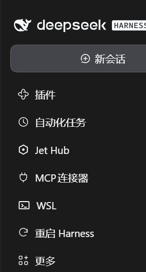

# dsh-relaunch

**English** | [中文](README.zh.md)

Restart DeepSeek Harness from its own sidebar.

🎯 The app has no restart command. This adds one — and unlike editing the
application's own files, it **survives application updates**.

> **Windows only.** The relaunch is implemented with Windows facilities
> (`wscript.exe` for a windowless launch, `taskkill` to terminate). On macOS and
> Linux the rail entry still appears, but pressing it fails cleanly rather than
> doing something unexpected.

## Why

DeepSeek Harness ships no UI for restarting itself. The top bar has an
*Applications* menu, and a restart item exists in the source — but it sits
behind a `development` flag that production builds never satisfy, so it is not
reachable.

The obvious workaround is to patch the application's `app.asar`. That works
until the first update: the updater replaces the archive wholesale, your patch
disappears, and the button is gone again. Editing another program's installed
files is also the kind of thing you have to redo forever.

So this does it from the outside. A plugin lives in your DSH profile, which
updates do not touch. It adds a rail entry to the sidebar; pressing the button
in the panel behind it closes Harness and starts it again.

## Features

| | |
| --- | --- |
| ⚡ One click | A rail entry beside the shipped panels |
| 🚫 No console flash | The worker is launched windowless, so nothing blinks on screen |
| 🚫 No confirmation dialog | Restart asks nothing; the panel's button *is* the confirmation |
| 🔁 Survives updates | Installed as a profile plugin, not carved into the app |
| 🔒 Explicit | The restart never fires on its own — it needs the button |
| 🌐 Localized | English and Chinese, following the app's language setting |

## What it looks like

The rail entry sits with the shipped panels, below WSL:



Selecting it opens the panel, whose single button performs the restart.

## Install

```bash
npm install @yishuiliufang/dsh-relaunch
```

Then add it to your profile's `package.json`:

```json
{
  "dsh": {
    "profile": {
      "bundles": ["...", "@yishuiliufang/dsh-relaunch"]
    }
  }
}
```

The bundle ships its own `cordis.patch.yml`, which inserts the plugin row
process-wide. **A profile restart is required** — the loader reads its
composition at startup, and the sidebar does not gain the entry until then.

## Use

Click the circular-arrow icon in the left rail. The panel has one button.

Pressing it:

1. Sends a request to the plugin's own Host route.
2. Waits a moment so the response can reach the browser first.
3. Terminates the running Harness processes.
4. Starts the application again, verifies it stayed up, and records each step.

**Everything running is interrupted.** That is what a restart is — DSH
checkpoints sessions as it goes, so your conversation history survives, but a
task executing at that moment does not.

## How it works

The restart cannot be done from inside the plugin, because the plugin *runs
inside the process being restarted*. Leaving it to an in-process call would mean
the process kills itself mid-response, and any child it started would die with
it. So the work goes to a detached worker:

```
rail button
  └─ POST /dsh-relaunch/restart          (Host half, authenticated route)
       └─ wscript.exe launch-hidden.vbs  (GUI subsystem: no console allocated)
            └─ DeepSeek Harness.exe      (ELECTRON_RUN_AS_NODE=1: Node, windowless)
                 └─ restart-harness.mjs  (terminate → wait → start → verify)
```

Two details are load-bearing:

- **The launcher is `wscript.exe`, not `powershell.exe`.** PowerShell is a
  *console*-subsystem program: starting it allocates a console window that
  flashes on screen, and the WMI route used to detach it cannot ask for
  `CREATE_NO_WINDOW`. The Harness executable is a *GUI*-subsystem binary, so
  running it in Node mode produces no window at all.
- **The worker strips `ELECTRON_RUN_AS_NODE` before restarting the app.** That
  variable is what makes the worker run as Node instead of as the desktop app.
  It is process-scoped, so it is inherited — and an Electron binary that inherits
  it starts as a bare Node runtime with no application logic and exits within a
  second, leaving *nothing* running. `test/host.mjs` pins this.

## Requirements

- **Windows.**
- DSH desktop `>= 0.1.7-rc.2` (`engines.dsh`).

The plugin declares **no `@deepseek-ai/*` peer dependency** and imports none of
their values. That is deliberate: at startup DSH runs a compatibility check over
every profile bundle, and if even one peer range fails to cover the running
version, the whole bundle is skipped — `cordis.patch.yml` never takes effect and
it looks like "installed but nothing happens". With no peer range to check, that
failure cannot occur here.

## Configuration

None. The plugin has no options; the route and the delay are fixed.

## Known limitations

- **Windows only**, as noted above. The rail entry appears elsewhere but the
  restart fails there.
- **Running tasks are interrupted.** Not a bug, but worth repeating.
- **The plugin needs a profile restart to appear.** Installing it while Harness
  runs links the package, but the sidebar picks up the entry only after the app
  restarts.
- **Only one restart should be in flight at a time.** The button disables itself
  while a restart is running, but nothing prevents a second window from pressing
  it too.

## Project layout

```
dsh-relaunch
├── index.js            # Host half: registers the restart route
├── client.js           # Client half: the rail entry and its panel
├── restart-harness.mjs # The detached worker: terminate, wait, relaunch, verify
├── launch-hidden.vbs   # Windowless launcher (wscript → Node mode)
├── restart-harness.ps1 # Transition shim; see CHANGELOG for why it remains
├── locale/             # Plugin-list metadata (en, zh)
├── icon.svg            # Plugin-list icon
├── test/
│   ├── manifest.mjs    # Package/manifest wiring (16 checks)
│   ├── host.mjs        # Route contract and the relaunch environment (11 checks)
│   └── client.mjs      # Client mount, localization, panel states (17 checks)
├── cordis.patch.yml    # Bundle layer: inserts the plugin row
├── dsh-plugin.json     # Plugin manifest
├── CHANGELOG.md        # Release notes
└── package.json
```

## Tests

```bash
npm test
```

No DSH host and no dependencies are needed — the suites import only Node
builtins. `host.mjs` covers the environment leak described above, which is the
one bug in this project that produced a *worse* outcome than having no plugin at
all.

## Changelog

See [CHANGELOG.md](CHANGELOG.md) for what changed in each release.

## License

MIT
